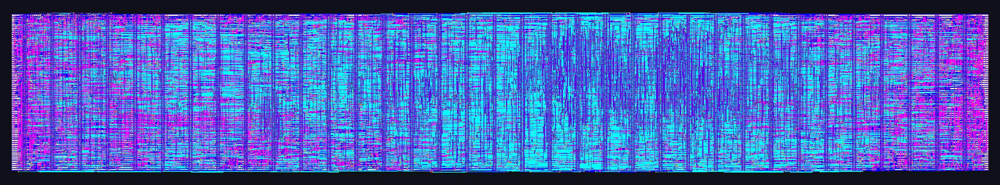

   

# Backplane INet MCU (`backplane-inet-mcu`)

An autonomous, dual-tile **Interaction-Net Microcontroller** designed and formally verified with **Backplane** for a **Tiny Tapeout SKY130 `8×2`** (16-tile) shuttle slot (`tinytapeout-sky-26e`).

No register file, no call stack, no RTOS, no locks, and no cache coherency. Programs compile from Vine-style interaction nets into external QSPI XIP Flash (`CS0_n`), reduce across two Chase-Lev LIFO work-stealing tiles using resettable synchronous DFF hot slots (`1` hot node, `1` hot wire, `1`-entry/tile deques, `0` latches, single clock tree `clk`) backed by dual external QSPI PSRAM (`CS1_n` / `CS2_n`), and pair with a Nordic-nRF + RP2040-PIO-inspired autonomous peripheral fabric.



## Architecture at a Glance

| Subsystem | Module | What It Does | Area (`µm²`) | % of `8×2` Core |
|---|---|---|---:|---:|
| **INet Compute Core + ALU** | `inet_core`, `inet_alu`, `inet_latch_rf` | 2-tile Chase-Lev LIFO reducer (`1`-entry/tile DFF deques), `1` hot node + `1` hot wire (`0` latches), 16-op SMT-proven ALU | `55,962.42` | `18.50%` |
| **RP2040-Style PIO** | `inet_pio` | Deterministic 1-cycle 9-op PIO SM (`JMP, WAIT, IN, OUT, PUSH, PULL, MOV, IRQ, SET`), `4×16b` DFF IMEM, side-set/delay, DMA + PPI | `12,889.86` | `4.26%` |
| **Unified `SERCOM`** | `inet_sercom` | Runtime-reconfigurable UART / SPI / open-drain I2C sharing one address space, shift register, `8`-bit divider, and `1`-byte FIFO | `10,800.36` | `3.57%` |
| **Linear IO Bridge** | `inet_io_bridge` | Non-blocking linear IO continuations + peripheral/SWD bus arbiter | `8,820.96` | `2.92%` |
| **Math / ML Accelerator** | `inet_accel` | Bit-serial signed multiplier (`0` `*` blocks): `4×INT8` SIMD dot-product or `16×16` Q15 MAC with ReLU, shift, and saturation | `8,630.78` | `2.85%` |
| **ARM ADIv5 SWD Target** | `inet_swd` | Halt, step, resume, inspect hot/cold state over 2-wire `SWCLK`/`SWDIO` | `8,216.63` | `2.72%` |
| **Linked-List EasyDMA** | `inet_dma` | 4-word PSRAM descriptor chains across PSRAM A, `SERCOM`, `PIO`, `PWM0/1`, `Accelerator`, and INet pair injection | `8,010.18` | `2.65%` |
| **3-CS QSPI Controller** | `inet_qspi_ctrl` | Shared `SCK` + `IO[3:0]` for Flash XIP (`CS0_n`), PSRAM A cold arena (`CS1_n`), and PSRAM B active-pair spill ring (`CS2_n`) | `5,899.41` | `1.95%` |
| **Timers / Counters / PWM** | `inet_timer` | 2× Timer/Counter/PWM (`12`-bit `T0`, `10`-bit `T1`) with compare/period events and EasyDMA PWM duty pacing | `5,609.13` | `1.85%` |
| **PPI Task/Event Crossbar** | `inet_ppi` | 4-channel autonomous `12` events × `8` tasks crossbar, including `TASK_INET_INJECT` directly into the INet tiles | `4,595.66` | `1.52%` |
| **GPIO Pin-Select Crossbar** | `inet_gpio_xbar` | Nordic `PSEL`-style remapping across all non-QSPI/non-SWD user pins (QSPI and SWD stay hardwired) | `3,907.50` | `1.29%` |
| **Top-Level Integration** | `tt_um_inet_mcu` | QSPI/DMA arbiter & dual-mode (`ui[6]`) pin mux (`mole99` QSPI Pmod compatible) | `1,680.36` | `0.56%` |
| **Hierarchical Total (`8×2`)** | **`tt_um_inet_mcu`** | **`15,883` cells (`38.97%` sequential, `0` latches)** | **`135,023.25`** | **`44.65%`** |
| **Flat Synthesized Top (`8×2`)** | **`tt_um_inet_mcu`** | **`15,632` cells (`2,092` DFFs, `0` latches, `35,150` NAND2 GE)** | **`131,937.79`** | **`43.63%`** |

*(Module breakdown measured via hierarchical Yosys `sky130_fd_sc_hd__tt_025C_1v80` at `40 ns` [`-D 40000`]; flat total measured via `./scripts/synth_sky130.sh` at `20 ns` [`-D 20000`]; `302,420 µm²` `8×2` core area.)*

## SKY130 `8×2` Hardening & Signoff Summary

| Metric / Check | Result | Details |
|---|---|---|
| **Flow & PDK** | **PASS (exit 0)** | LibreLane `3.0.14`, `sky130A` (`open_pdks` `8afc8346`), `CLOCK_PERIOD = 40 ns` (`25 MHz` target) |
| **Die / Core Footprint** | **`1378.16 × 225.76 µm`** | `311,133 µm²` die area, `302,420 µm²` core area |
| **Utilization** | **`57.90%` final stdcell** | `175,089 µm²` (`18,952` stdcells incl. `4,399` tap cells & `701` antenna diodes); `56.72%` post-`RepairDesignPostGPL`; `62.10%` reported at global placement |
| **Routing & DRC** | **`0` DRT DRC errors** | `997,104 µm` wirelength, `166,066` vias (`Checker.TrDRC` clear) |
| **Physical Signoff & LVS** | **`0` Magic DRC / `0` LVS** | `0` Magic DRC errors, `0` Magic illegal overlaps, `0` Netgen LVS device/net/pin mismatches |
| **Multi-Corner STA (9 PVT corners)** | **`0` setup / `0` hold violations** | Worst setup slack **`+7.904 ns`** (`max_ss_100C_1v60` -> **`31.16 MHz` Fmax**, `+21.970 ns` @ `nom_tt_025C_1v80`); worst hold slack **`+0.035 ns`** |
| **OpenROAD Antenna Check** | `17` nets / `20` pins | Reduced `266 → 73 → 34 → 17` nets via `701` `diode_2` cells over `3` post-DRT repair passes (non-blocking in LibreLane; not part of SKY130 TT precheck) |
| **Tiny Tapeout Precheck (`sky130A`)** | **17 / 17 PASS (`✅`)** | Magic DRC, KLayout FEOL/BEOL/offgrid/zero-area/pin-overlap/checks, Pin, Boundary, Power pin, Layer, Cell name, Well rules, Analog pin, Verilog syntax |
| **Gate-Level Sim (`GATES=yes`)** | **4 / 4 PASS** | Full cocotb + Icarus Verilog (`sky130_fd_sc_hd.v` + `tt_submission/tt_um_inet_mcu.v`), `50,362,200 ns` simulated (`427.65 s` wall time) |

## Measured Benchmarks (RTL & Gate-Level Netlist)

Full-chip cycle-accurate simulation (`test/test.py`) with external QSPI Flash XIP (`CS0_n`) and dual QSPI PSRAM (`CS1_n`/`CS2_n`) — **all 5 Vine benchmarks pass bit-exact with identical cycle and reduction counts on both Verilator RTL and SKY130 post-PnR Gate-Level (`GATES=yes`) Icarus Verilog**:

| Benchmark | `ROOT(0)` | Redex | Cycles | QSPI Txns | PSRAM Spills | Hot Hits | Peripherals Verified |
|---|---:|---:|---:|---:|---:|---:|---|
| `smoke_arith` | `0x300050` | `17` | `6,066` | `90` | `2` | `1` | `UART=[33]` |
| `periph_io` | `0x300084` | `241` | `104,256` | `1,563` | `67` | `10` | `UART=[79, 75]`, `SPI=[165]`, `I2C=[160, 90]` |
| `fib_rec` | `0x300015` | `871` | `369,100` | `5,604` | `195` | `87` | — |
| `fsm_branch` | `0x30002e` | `582` | `283,452` | `4,271` | `127` | `21` | — |
| `par_map_reduce` | `0x3005b8` | `729` | `323,264` | `4,866` | `164` | `16` | — |

## Verification Status

- **LibreLane SKY130 `8×2` Hardening (`runs/wokwi/`):** Exit code `0` — `0` DRT DRC, `0` Magic DRC, `0` illegal overlap, `0` Netgen LVS, `0` setup/hold violations across all 9 PVT corners (`31.16 MHz` worst-corner Fmax).
- **Tiny Tapeout SKY130A Precheck (`tt/precheck/precheck.py`):** 17/17 checks `✅` PASS on `tt_submission/tt_um_inet_mcu.gds`.
- **Gate-Level Simulation (`GATES=yes`, `SIM=icarus`):** 4/4 cocotb suites PASS on post-PnR `tt_submission/tt_um_inet_mcu.v` (`test_reset_and_swd_debug`, `test_pmod_mode_and_qspi_lat`, `test_benchmarks_equivalence`, `test_nordic_pio_pwm_xbar_dma`).
- **Exhaustive ALU SMT proof (`sby -f formal/inet_alu.sby`, `bitwuzla`):** PASS across all `16 × 2^32` inputs.
- **Z3 formal & compiler suite (`pytest spec/formal_checks.py compiler/test_compiler.py`):** 13/13 PASS (confluence across `fifo`/`lifo`/`rr_tiles`/`random`, 0 leaks).
- **Full-chip Verilator cocotb (`test/test.py`, `SIM=verilator`):** 4/4 PASS — 5/5 Vine benchmarks bit-exact + full autonomous peripheral test (`GPIO XBAR` remapping, `Timer/PWM` + EasyDMA ramp, `PPI` `TASK_INET_INJECT`, `PIO` 4×16 DFF-IMEM DMA loopback, chained EasyDMA `4×INT8` SIMD + `Q15` ReLU MAC), plus 7/7 module unit tests (`test_io_bridge.py`, `test_peripherals.py`, `test_qspi_swd.py`).
- **Verilator Lint & SKY130 Synthesis (`./scripts/synth_sky130.sh`):** Verilator `--lint-only -Wall` PASS (0 warnings), `131,937.79 µm²` (`43.63%` raw of `8×2`, `0` latches).

## Pinout (Mode 0 Full MCU / Mode 1 `mole99` QSPI Pmod)

- **Static QSPI (shared `SCK` + `IO[3:0]`):** `uo[0]` `QSPI_CS0_n` (Flash XIP), `uo[1]` `QSPI_CS1_n` (PSRAM A), `uio[7]` `QSPI_CS2_n` (PSRAM B), `uo[2]` `QSPI_SCK`, `uio[3:0]` `QSPI_IO[3:0]`. Set `ui[6]=1` for drop-in `mole99` QSPI Pmod pinout (`ui[5:4]` sets QSPI capture latency).
- **Static SWD:** `ui[0]` `SWCLK`, `uio[4]` `SWDIO`.
- **Crossbar-mapped user pins (`inet_gpio_xbar`):** `ui[1,3,7]`, `uo[7:3]`, `uio[6:5]` (defaulting to UART on TT RP2350 UART1, SPI, open-drain I2C, and STATUS; remappable at runtime to `SERCOM`, `PIO`, `Timer/PWM`, or `GPIO`).

## Running Locally

```bash
# Formal spec + compiler tests
pytest spec/formal_checks.py compiler/test_compiler.py

# Full-chip Verilator cocotb simulation
(cd test && make SIM=verilator EXTRA_ARGS="--timing")

# Gate-level Icarus cocotb simulation (after copying tt_submission/tt_um_inet_mcu.v to test/gate_level_netlist.v)
(cd test && make GATES=yes)

# SKY130 8x2 Yosys synthesis & area report
./scripts/synth_sky130.sh
```

## Documentation

- [docs/architecture.md](docs/architecture.md) — Full ISA, 24-bit tagged port ABI, Chase-Lev LIFO microarchitecture, area sweeps, and peripheral register maps.
- [docs/info.md](docs/info.md) — Tiny Tapeout datasheet & pinout reference.
- [benchmarks/BENCHMARK_REPORT.md](benchmarks/BENCHMARK_REPORT.md) — Detailed telemetry and Cortex-M0+ / RISC-V comparisons.
