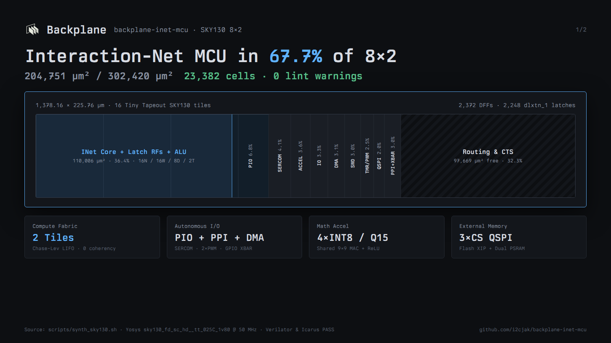
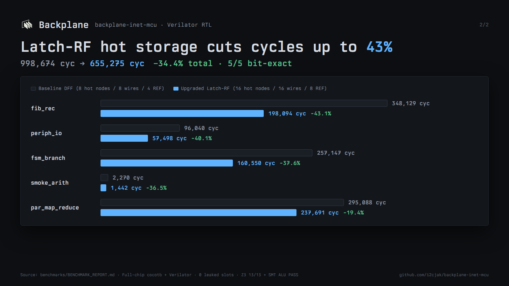

   

# Backplane INet MCU (`backplane-inet-mcu`)

An autonomous, dual-tile **Interaction-Net Microcontroller** designed and formally verified with **Backplane** for a **Tiny Tapeout SKY130 `8×2`** (16-tile) shuttle slot (`tinytapeout-sky-26e`).

No register file, no call stack, no RTOS, no locks, and no cache coherency. Programs compile from Vine-style interaction nets into external QSPI XIP Flash (`CS0_n`), reduce across two Chase-Lev LIFO work-stealing tiles using SKY130 `dlxtn_1` latch-RF hot storage backed by dual external QSPI PSRAM (`CS1_n` / `CS2_n`), and pair with a Nordic-nRF + RP2040-PIO-inspired autonomous peripheral fabric.



## Architecture at a Glance

| Subsystem | Module | What It Does | Area (`µm²`) | % of `8×2` Core |
|---|---|---|---:|---:|
| **INet Compute Core + ALU + Latch RFs** | `inet_core`, `inet_alu`, `inet_latch_rf` | 2-tile Chase-Lev LIFO reducer, 16 hot nodes + 16 hot wires + 8-entry REF dir cache (`1,992` `dlxtn_1` latches), 16-op SMT-proven ALU | `110,005.50` | `36.37%` |
| **RP2040-Style PIO** | `inet_pio` | Deterministic 1-cycle 9-op PIO SM (`JMP, WAIT, IN, OUT, PUSH, PULL, MOV, IRQ, SET`), `16×16b` latch IMEM, side-set/delay, DMA + PPI | `20,611.02` | `6.82%` |
| **Unified `SERCOM`** | `inet_sercom` | Runtime-reconfigurable UART / SPI / open-drain I2C sharing one address space, shift register, divider, and FIFO | `12,421.91` | `4.11%` |
| **Math / ML Accelerator** | `inet_accel` | Shared `9×9` signed multiplier: 4-cycle `4×INT8` SIMD dot-product or `16×16` Q15 MAC with ReLU, shift, and saturation | `10,963.01` | `3.62%` |
| **Linear IO Bridge** | `inet_io_bridge` | Non-blocking linear IO continuations + peripheral/SWD bus arbiter | `9,900.75` | `3.27%` |
| **Linked-List EasyDMA** | `inet_dma` | 4-word PSRAM descriptor chains across PSRAM A, `SERCOM`, `PIO`, `PWM0/1`, `Accelerator`, and INet pair injection | `9,328.95` | `3.08%` |
| **ARM ADIv5 SWD Target** | `inet_swd` | Halt, step, resume, inspect hot/cold state over 2-wire `SWCLK`/`SWDIO` | `9,028.66` | `2.99%` |
| **Timers / Counters / PWM** | `inet_timer` | 2×16-bit Timer/Counter/PWM with compare/period events and EasyDMA PWM duty pacing | `7,414.61` | `2.45%` |
| **3-CS QSPI Controller** | `inet_qspi_ctrl` | Shared `SCK` + `IO[3:0]` for Flash XIP (`CS0_n`), PSRAM A cold arena (`CS1_n`), and PSRAM B active-pair spill ring (`CS2_n`) | `5,929.44` | `1.96%` |
| **PPI Task/Event Crossbar** | `inet_ppi` | 4-channel autonomous `12` events × `8` tasks crossbar, including `TASK_INET_INJECT` directly into the INet tiles | `4,604.42` | `1.52%` |
| **GPIO Pin-Select Crossbar** | `inet_gpio_xbar` | Nordic `PSEL`-style remapping across all non-QSPI/non-SWD user pins (QSPI and SWD stay hardwired) | `3,976.31` | `1.31%` |
| **Top-Level Integration** | `tt_um_inet_mcu` | QSPI/DMA arbiter & dual-mode (`ui[6]`) pin mux (`mole99` QSPI Pmod compatible) | `1,680.36` | `0.56%` |
| **Flat Synthesized Top (`8×2`)** | **`tt_um_inet_mcu`** | **`23,382` cells (`2,372` DFFs + `2,248` `dlxtn_1` latches, `54,548` NAND2 GE)** | **`204,751.37`** | **`67.70%`** |

*(Measured via `./scripts/synth_sky130.sh` with Yosys `sky130_fd_sc_hd__tt_025C_1v80` at 50 MHz; `302,420 µm²` `8×2` core area.)*

## Measured RTL Benchmarks

Full-chip cycle-accurate Verilator + cocotb simulation (`test/test.py`) with external QSPI Flash XIP (`CS0_n`) and dual QSPI PSRAM (`CS1_n`/`CS2_n`):



| Benchmark | `ROOT(0)` | Redex | Baseline (`8N/8W` DFF) | **Upgraded (`16N/16W` Latch-RF)** | Cycle Change | QSPI Txns | PSRAM Spills |
|---|---:|---:|---:|---:|---:|---:|---:|
| `fib_rec` | `21` | 871 | 348,129 | **198,094** | **-43.1%** | 2,901 *(was 5,349)* | 6 *(was 77)* |
| `periph_io` | `132` | 241 | 96,040 | **57,498** | **-40.1%** | 750 *(was 1,461)* | 1 *(was 11)* |
| `fsm_branch` | `46` | 582 | 257,147 | **160,550** | **-37.6%** | 2,310 *(was 3,912)* | 1 *(was 12)* |
| `smoke_arith` | `80` | 17 | 2,270 | **1,442** | **-36.5%** | 12 *(was 28)* | 0 |
| `par_map_reduce` | `1464` | 729 | 295,088 | **237,691** | **-19.4%** | 3,520 *(was 4,498)* | 10 *(was 23)* |

## Verification Status

- **Exhaustive ALU SMT proof (`sby -f formal/inet_alu.sby`, `bitwuzla`):** PASS across all `16 × 2^32` inputs.
- **Z3 formal & compiler suite (`pytest spec/formal_checks.py compiler/test_compiler.py`):** 13/13 PASS (confluence across `fifo`/`lifo`/`rr_tiles`/`random`, 0 leaks).
- **Full-chip cocotb (`test/test.py`, `SIM=verilator`):** 4/4 PASS — 5/5 Vine benchmarks bit-exact + full autonomous peripheral test (`GPIO XBAR` remapping, `Timer/PWM` + EasyDMA ramp, `PPI` `TASK_INET_INJECT`, `PIO` 16×16 latch-IMEM DMA loopback, chained EasyDMA `4×INT8` SIMD + `Q15` ReLU MAC).
- **Icarus Verilog (`SIM=icarus`):** Clean `-g2012 -Wall` compile + reset/SWD smoke PASS (`0` X-values).
- **SKY130 Synthesis (`./scripts/synth_sky130.sh`):** Verilator `-Wall` PASS (0 warnings), `204,751.37 µm²` (`67.70%` raw of `8×2`).

## Pinout (Mode 0 Full MCU / Mode 1 `mole99` QSPI Pmod)

- **Static QSPI (shared `SCK` + `IO[3:0]`):** `uo[0]` `QSPI_CS0_n` (Flash XIP), `uo[1]` `QSPI_CS1_n` (PSRAM A), `uio[7]` `QSPI_CS2_n` (PSRAM B), `uo[2]` `QSPI_SCK`, `uio[3:0]` `QSPI_IO[3:0]`. Set `ui[6]=1` for drop-in `mole99` QSPI Pmod pinout (`ui[5:4]` sets QSPI capture latency).
- **Static SWD:** `ui[0]` `SWCLK`, `uio[4]` `SWDIO`.
- **Crossbar-mapped user pins (`inet_gpio_xbar`):** `ui[1,3,7]`, `uo[7:3]`, `uio[6:5]` (defaulting to UART on TT RP2350 UART1, SPI, open-drain I2C, and STATUS; remappable at runtime to `SERCOM`, `PIO`, `Timer/PWM`, or `GPIO`).

## Running Locally

```bash
# Formal spec + compiler tests
pytest spec/formal_checks.py compiler/test_compiler.py

# Full-chip Verilator cocotb simulation
make -C test SIM=verilator

# SKY130 8x2 Yosys synthesis & area report
./scripts/synth_sky130.sh
```

## Documentation

- [docs/architecture.md](docs/architecture.md) — Full ISA, 24-bit tagged port ABI, Chase-Lev LIFO microarchitecture, area sweeps, and peripheral register maps.
- [docs/info.md](docs/info.md) — Tiny Tapeout datasheet & pinout reference.
- [benchmarks/BENCHMARK_REPORT.md](benchmarks/BENCHMARK_REPORT.md) — Detailed telemetry and Cortex-M0+ / RISC-V comparisons.
